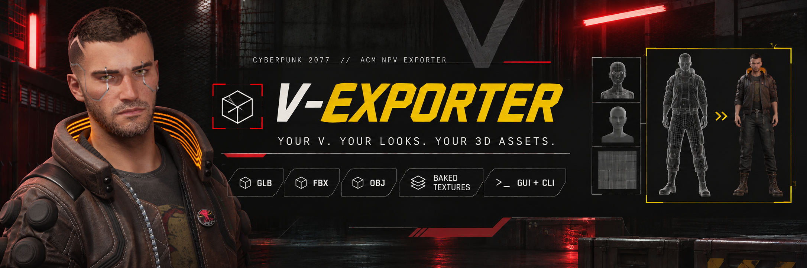

# V-Exporter



V-Exporter turns a Cyberpunk 2077 **V** captured by **Appearance Creator Mod (ACM)**
into 3D models. It reads an ACM NPV archive, imports each saved look into Blender, and
writes **GLB, FBX and OBJ** files with baked textures and optional 1024x1024 proof
images.

It has a GUI and a full headless CLI. No pip packages are required.

## Contents

- [Features](#features)
- [Requirements](#requirements)
- [Installation](#installation)
- [Quick start: GUI](#quick-start-gui)
- [CLI](#cli)
- [Output layout](#output-layout)
- [Settings](#settings)
- [Compatibility](#compatibility)
- [How it works](#how-it-works)
- [Troubleshooting](#troubleshooting)
- [Known limitations](#known-limitations)
- [Privacy and local data](#privacy-and-local-data)
- [Project layout](#project-layout)
- [Development notes](#development-notes)

## Features

- Exports every saved ACM look as its own folder.
- Writes GLB, FBX and OBJ from the same imported scene.
- Bakes the game material graph into a base-colour PNG per material.
- Keeps per-look textures in `<look>_textures/` next to the model files.
- Optional 1024x1024 proof render per look.
- GUI workflow for browsing NPVs and selecting looks.
- Headless CLI for scripting and batch exports.
- Self-test command for checking prerequisites.
- Doesn't write to the game, CET, ACM or Vortex folders.

## Requirements

| Component | Version | Notes |
|---|---|---|
| Windows | 10 or 11 | The GUI uses `os.startfile` and Windows path discovery. |
| Python | 3.9 or newer | The GUI needs `tkinter`, which is included in the standard python.org installer. |
| Cyberpunk 2077 | 2.5 | The uncook step needs a WolvenKit build that understands 2.5 archives. |
| WolvenKit CLI | 10.x | Download the `WolvenKit.Console-<version>.zip` asset. |
| .NET runtime | 10.0 | Required by WolvenKit CLI 10.x. |
| Blender | 5.0 or newer | The Cyberpunk Blender IO Suite 2.5.0 requires Blender 5.x. |
| Cyberpunk Blender IO Suite | 2.5.0 | Install the add-on ZIP through Blender's Add-ons panel. |
| Appearance Creator Mod | 2.71 or newer | Used to capture V's looks and create the NPV archive. |
| Disk space | Several GB | A full uncook cache can be large. |

Download links:

- WolvenKit: <https://github.com/WolvenKit/WolvenKit/releases>
- .NET 10: <https://dotnet.microsoft.com/download/dotnet/10.0>
- Blender: <https://www.blender.org/download/>
- Cyberpunk Blender IO Suite: <https://github.com/WolvenKit/Cyberpunk-Blender-add-on/releases>
- Appearance Creator Mod: <https://www.nexusmods.com/cyberpunk2077/mods/10795>

The game does not need to be running while exporting.

## Installation

1. Download or clone this repository.
2. Install the requirements from the table above.
3. Extract the WolvenKit CLI package. You can put `WolvenKit.CLI.exe` in
   `V-Exporter\tools\`, or place it anywhere and browse to it later.
4. Install the **Cyberpunk Blender IO Suite 2.5.0** ZIP in Blender through
   *Edit > Preferences > Add-ons > Install from Disk*. Enable the add-on after
   installing it.
5. Open a terminal in the V-Exporter folder and run the self-test:

   ```bat
   python v_exporter.py --selftest
   ```

   The self-test checks Python, `tkinter`, WolvenKit, Blender, the add-on, the game
   folder, the ACM NPV folder and the output folder. It does not export anything.

6. If any path is missing, start the GUI and use **Auto-detect** or **Browse**, or run:

   ```bat
   python v_exporter.py --detect --save
   ```

## Quick start: GUI

1. Start Cyberpunk 2077 with ACM and the body, clothing and hair mods you want active.
2. In ACM, save each outfit or look you want to export with a clear look name.
3. Open ACM's **NPV** tab, tick the wardrobe outfits you want included and press
   **Create NPV**. Leave ACM's **Protected** option off.
4. Quit the game.
5. Start V-Exporter:

   ```bat
   python v_exporter.py
   ```

6. Set the required paths. Auto-detect usually finds the game and Blender. WolvenKit
   often needs to be browsed to.
7. Press **Rescan**. Packed NPVs can be ticked. Draft NPVs are greyed out until you press
   **Create NPV** in game.
8. Tick one or more NPVs. Their cached looks appear on the right. Press **Scan looks
   (uncook)** if the cache does not exist yet.
9. Select the looks you want, or leave all looks unticked to export every discovered
   look.
10. Press **EXPORT SELECTED NPVs**.

The **Force re-uncook** checkbox ignores the cache. Use it after changing the NPV in
game. The **Render 1024x1024 proofs** checkbox is on by default and can be switched off
to save time.

## CLI

Any argument runs the headless CLI instead of the GUI. It uses the same pipeline and
settings, and never opens a Tk window.

```bat
python v_exporter.py --help
python v_exporter.py --list
python v_exporter.py --scan --npv MyV
python v_exporter.py --export --npv MyV --looks casual_01,outfit_01
python v_exporter.py --export --npv MyV --all-looks --no-proofs
python v_exporter.py --detect --save
python v_exporter.py --selftest
python v_exporter.py --open-output
```

`python cli.py ...` also works.

| Command or option | Meaning |
|---|---|
| `--list` | List NPV folders and cached look names. Does not uncook. |
| `--scan` | Uncook the selected NPVs and list their looks. |
| `--export` | Export the selected NPVs and looks. With no `--npv`, every packed NPV is exported. |
| `--detect` | Auto-detect game, Blender, WolvenKit, NPV and output paths. |
| `--selftest` | Validate settings and dependencies without exporting. |
| `--open-output` | Open the configured output folder. |
| `--npv NAME` | NPV name. Repeat the flag or use a comma-separated list. |
| `--looks LIST` | Look names. Repeat the flag or use a comma-separated list. Default: all discovered looks. |
| `--all-looks` | Explicitly export every discovered look. |
| `--force-uncook` | Ignore the uncook cache. Valid with `--scan` and `--export`. |
| `--proofs` | Render 1024x1024 proof images. |
| `--no-proofs` | Skip the proof render. |
| `--wolvenkit-cli PATH` | Override `wolvenkit_cli` for this run. |
| `--blender PATH` | Override the Blender executable. |
| `--game-root PATH` | Override the Cyberpunk 2077 folder. |
| `--npv-root PATH` | Override the ACM NPV folder. |
| `--output-root PATH` | Override the export destination. |
| `--save` | Save path or proof overrides to `settings.json`. |
| `--json` | Print a machine-readable result on stdout. Logs go to stderr. |
| `--quiet` | Suppress normal log lines. Warnings and errors still print. |
| `--verbose` | Print tracebacks for per-NPV failures. |

For several NPVs with different looks, use `NPV=look1,look2`:

```bat
python v_exporter.py --export --looks "MyV=casual_01,outfit_01" --looks "OtherV=formal"
```

More examples:

```bat
:: Inspect available looks without exporting
python v_exporter.py --list
python v_exporter.py --scan --npv MyV --force-uncook

:: Export one outfit and skip the proof render
python v_exporter.py --export --npv MyV --looks casual_01 --no-proofs

:: Export every packed NPV and every look
python v_exporter.py --export --all-looks

:: Let the CLI discover missing paths, then remember them
python v_exporter.py --detect --save

:: Machine-readable result for scripting
python v_exporter.py --export --npv MyV --json --quiet
```

Exit codes:

- `0`: success
- `1`: setup or export error
- `2`: invalid CLI usage

With `--json`, stdout contains only the JSON result. All logs go to stderr.

## Output layout

```text
<output folder>\<NPV name>\
  textures\                       shared textures (may be empty)
  <look>\
    <look>_textures\              this look's baked and traced PNGs
    <look>.glb
    <look>.fbx
    <look>.obj
    <look>.mtl
  proof_<look>.png                1024x1024 preview
  export-summary.json
```

Each look is self-contained. GLB and FBX embed their textures. The OBJ `.mtl` uses
relative paths into `<look>_textures/`, so keep that folder next to the `.obj` when you
move or share the look folder.

The top-level `textures/` folder is reserved for textures shared by multiple looks. It
is created as a placeholder and stays empty in the current version.

Older exports used a flat `<NPV>\<look>.glb` layout. Those files are not deleted
automatically. Re-export into a fresh output folder, or remove the old flat files, if
you want a clean tree.

## Settings

`settings.json` is created on first run and is gitignored so local paths are not
published. A tracked example lives in `settings.example.json`.

```json
{
  "wolvenkit_cli": "C:\\path\\to\\WolvenKit.CLI.exe",
  "blender": "C:\\path\\to\\blender.exe",
  "game_root": "C:\\path\\to\\Cyberpunk 2077",
  "npv_root": "",
  "output_root": "C:\\path\\to\\V-Exports",
  "render_proofs": true,
  "entity_overrides": {}
}
```

| Key | Meaning |
|---|---|
| `wolvenkit_cli` | Full path to `WolvenKit.CLI.exe`. |
| `blender` | Full path to `blender.exe`. |
| `game_root` | Folder containing `bin\x64\Cyberpunk2077.exe`. |
| `npv_root` | Optional ACM NPV folder override. Empty means it is derived from `game_root`. |
| `output_root` | Export destination. |
| `render_proofs` | Render a 1024x1024 `proof_<look>.png` per look. |
| `entity_overrides` | Force a specific `.ent.json` for one NPV. Useful when several entities are found and the wrong one is picked. |

The default output folder is `<tool>\exports`.

## Compatibility

The exporter imports whatever ACM packed into the NPV. It does not have body-mod-specific
code.

| Setup | Status | Notes |
|---|---|---|
| Vanilla female body | Supported | Uses the same base-game body meshes and skin material paths as a modded body. A vanilla-only NPV was not run during development, so export one test look first. |
| Hyst Angel body | Tested | Used for the main development exports. Body, skin and refitted clothing export normally. |
| Modded clothing (ArchiveXL / CCXL) | Tested | Materials are resolved through the mod's own `.mi` / `.mlsetup` chain when available. |
| Vanilla clothing | Supported | Uses the same material remap path as modded clothing. |
| Face, head and eyes | Supported with fallback | The head is imported through its morph target and cached head/eye siblings. |
| CCXL or animated hair | Known limitation | Some hair parts depend on a `.rig` and a multi-buffer `hair_shadow.mesh` that the headless pipeline cannot import. Hair may be missing or incomplete. |
| Custom body with a non-standard rig | Test one look first | Skinning quality depends on the rig the add-on builds. |
| Male V | Untested or partial | Body and clothing geometry export, but the automatic arm material repair is written around the female arm atlas. |

If a look uses a mod that ACM did not pack into the NPV, the missing asset cannot be
exported. The log names unresolved references and the rest of the look still exports.

## How it works

1. V-Exporter finds ACM NPV folders under
   `<game>\bin\x64\plugins\cyber_engine_tweaks\mods\AppearanceCreatorMod\NPV`.
2. It uncooks the NPV archive with WolvenKit CLI into
   `work/<NPV>/source/raw`.
3. It heals missing material and texture dependencies and remaps the material JSONs.
4. It runs Blender once per look and imports the appearance with the Cyberpunk Blender
   IO Suite.
5. It bakes the imported base colour into a PNG per material.
6. It writes GLB, FBX and OBJ into the look folder.
7. It optionally renders a 1024x1024 proof image.
8. It writes `export-summary.json` and logs everything to `v_exporter.log`.

The tool only reads the game and NPV folders. It never writes to the game folder, CET,
ACM or Vortex.

Detailed implementation notes and reverse-engineering findings are in
[EXPORT-RESEARCH.md](EXPORT-RESEARCH.md) and [research-notes.md](research-notes.md).

## Troubleshooting

| Symptom | Cause or fix |
|---|---|
| `[FAIL] WolvenKit CLI` in the self-test | The path is missing or wrong. Browse to `WolvenKit.CLI.exe`. |
| NPV folder field points at the game folder | The tool corrects a game root to the ACM NPV folder. Re-browse if the correction is wrong. |
| NPV listed as `DRAFT` | In game, open ACM's **NPV** tab and press **Create NPV**. Then press **Rescan**. |
| CLI exits immediately or `UNCook failed` | Install the .NET 10 runtime and use WolvenKit CLI 10.x for game 2.5. |
| Uncook fails but the archive exists | Recreate the NPV with ACM's **Protected** option off. Keep the `.archive` and `.archive.xl` from the same Create NPV run. |
| `[FAIL] CP77 add-on` | Install Cyberpunk Blender IO Suite 2.5.0 and enable it in Blender. |
| `Import failed` with an add-on API error | Add-on and Blender versions may be mismatched. Use add-on 2.5.0 with Blender 5.x. |
| A body part is missing | The NPV may contain a corrupt mesh copy. The tool tries to heal it from the game or mod archives. Re-run the export. |
| Hair is missing | Known limitation. CCXL hair often uses assets the headless importer cannot load. Body and clothing still export. |
| FBX shows shards in some viewers | The exporter dedupes to one rig. A third-party viewer may still handle bones or units badly. Re-import in Blender or use the GLB. |
| OBJ has pink or untextured materials | Keep `<look>_textures/` next to the `.obj` and `.mtl`. |
| Materials look flat | The bake may have failed for that material. Check the `bake` block in `export-summary.json`. |
| Output folder is empty | Check the per-NPV section of the log and `export-summary.json`. |

For a quick first-run check, use `--selftest`, `--list` and `--scan`.

## Known limitations

- Base colour is baked and flattened. Normals, specular, ORM and parallax are not baked.
- Multilayer garments are approximations. Layer masks and per-layer detail are lost.
- Headless material baking is not officially documented by the add-on authors, so some
  materials may fall back to a traced albedo or flat colour.
- Some CCXL or animated hair parts cannot be imported headless.
- A full uncook can take several minutes and several GB of disk space.
- ACM's internal NPV archive layout is unpublished. The tool discovers files by globbing
  and parses JSON defensively.
- Look names are sanitized for the file system. The original names remain in
  `export-summary.json` and the log.
- Windows only.
- Proof images are previews, not game screenshots. They use the imported Blender
  materials and a simple studio light rig.

## Privacy and local data

`settings.json`, `v_exporter.log` and the `work/` uncook cache are gitignored. They can
contain absolute paths, NPV names, look names and uncooked game assets. Review them
before attaching a log or cache folder to a public issue.

The output folder, defaulting to `<tool>\exports`, is also gitignored. Review exported
models, textures and proof images before sharing them.

## Project layout

```text
V-Exporter/
  v_exporter.py      GUI and CLI entry point
  cli.py             headless command-line interface
  pipeline.py        discovery, uncook and export orchestration
  blender_export.py  headless Blender exporter, one look per run
  material_remap.py  material and texture-chain repair
  settings.json      local settings, created on first run
  settings.example.json
  v_exporter.log     rolling log
  work/              uncook cache, safe to delete
  exports/           default output folder
  V-Exporter_banner.png
  EXPORT-RESEARCH.md detailed export pipeline research
  research-notes.md  source and CLI research notes
```

## Development notes

- The code is standard library only. Do not add pip dependencies without a strong reason.
- The GUI and CLI both call the same functions in `pipeline.py`.
- Blender-side work belongs in `blender_export.py` and runs inside Blender, not the main
  Python process.
- Material repair belongs in `material_remap.py`.
- Keep user-specific paths, NPV names and character names out of committed files.
- Run `python v_exporter.py --selftest` and `python -m py_compile *.py` before committing.

## Credits

- [WolvenKit](https://github.com/WolvenKit/WolvenKit) for the CLI uncook and mesh export
  tools.
- [Cyberpunk Blender IO Suite](https://github.com/WolvenKit/Cyberpunk-Blender-add-on)
  for the entity importer used by the headless Blender step.
- [Appearance Creator Mod](https://www.nexusmods.com/cyberpunk2077/mods/10795) for
  capturing V's looks and producing the NPV archive.
- The Cyberpunk 2077 modding community for the public documentation and tooling that made
  this pipeline possible.
